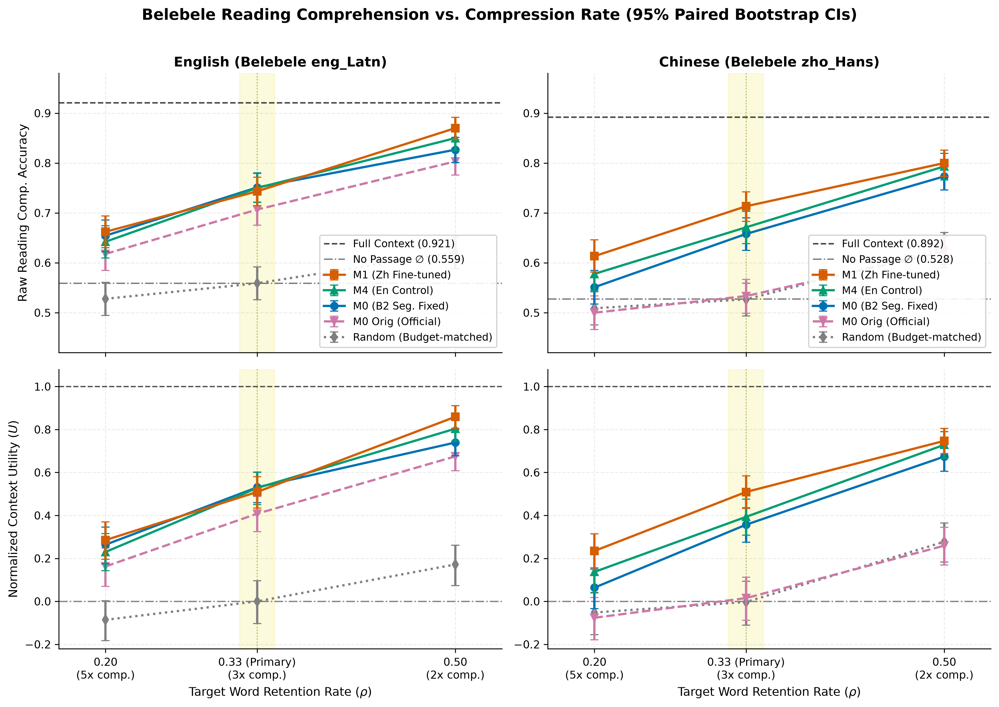
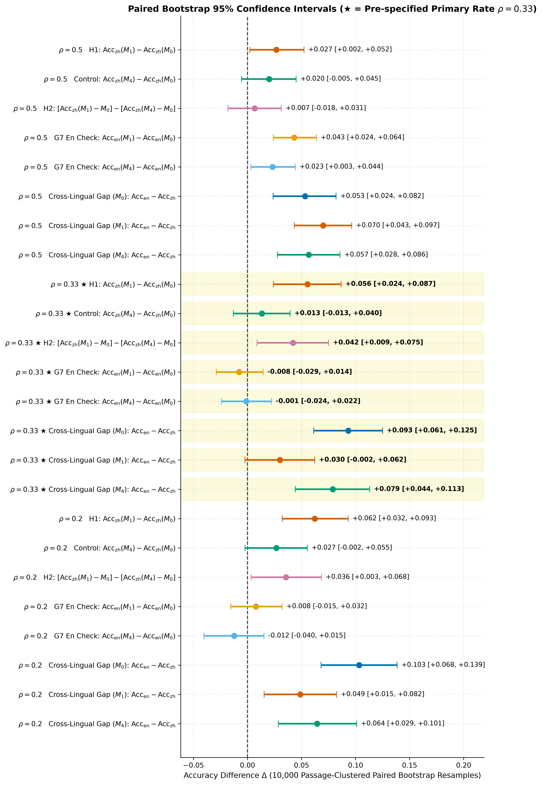
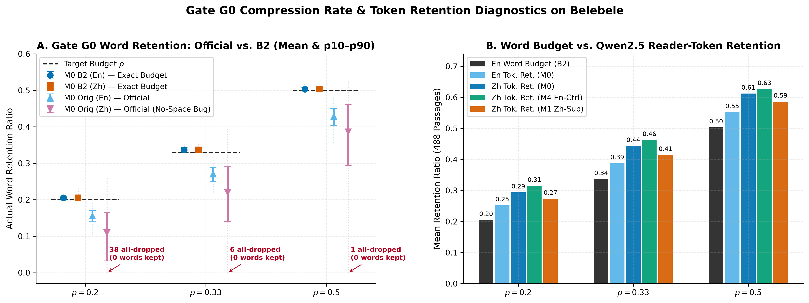
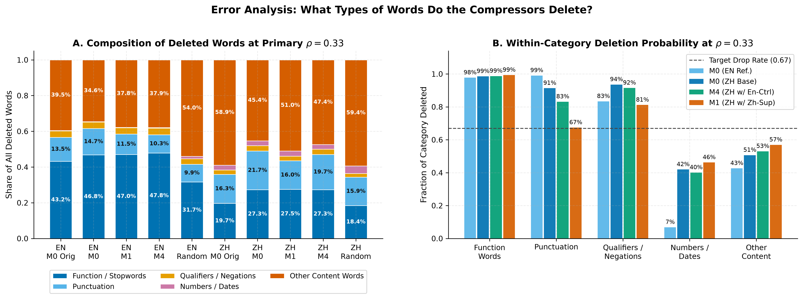
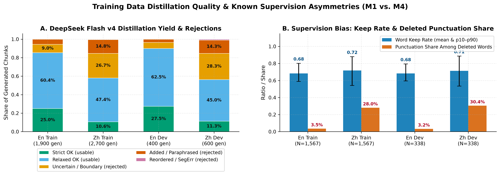

# Experimental Results and Key Findings (Milestone & Core Evaluation)

> 🌐 **Language**: **English Version** | **[中文版 (RESULTS_zh.md)](RESULTS_zh.md)**

This document summarizes the complete experimental results, engineering gate outcomes (G0–G7), pre-specified hypothesis tests (H1 & H2), deleted-word error analysis, and publication figures for our interventional study on cross-lingual extractive prompt compression.
* **Protocol & Decision Log**: [DECISIONS.md](DECISIONS.md) (Sections B11 & B12)
* **Automated Evaluation Report**: [results/eval_report.md](results/eval_report.md) & [results/eval_report.json](results/eval_report.json)
* **Gate G0/G7 Compression Diagnostics**: [results/compress/g0_report.json](results/compress/g0_report.json)
* **Distillation Summary Statistics**: [data/labels/summary.json](data/labels/summary.json)

---

## 1. Experimental Setup Overview (Core)

| Component | Locked Configuration |
|---|---|
| **Base Compressor (`M0`)** | `microsoft/llmlingua-2-xlm-roberta-large-meetingbank` (revision `ebaba9b0e874dadd3003ffcff828e4397e568089`) |
| **Chinese-Supervised Model (`M1`)** | Fine-tuned from `M0` on `zh_train.jsonl` (1,567 Chinese Wikipedia chunks distilled from teacher), checkpoint selected on `zh_dev.jsonl` (338 chunks) ([`supermaxxxx/713-crosslingual-compression-m1`](https://huggingface.co/supermaxxxx/713-crosslingual-compression-m1)) |
| **Matched English Control (`M4`)** | Fine-tuned from `M0` on `en_train.jsonl` (1,567 English Wikipedia chunks from the same teacher) with **identical training steps, batch size, learning rate, max sequence length, and `-100` special/pad masking**, checkpoint selected on `en_dev.jsonl` (338 chunks) ([`supermaxxxx/713-crosslingual-compression-m4`](https://huggingface.co/supermaxxxx/713-crosslingual-compression-m4)) |
| **Distillation Teacher** | `deepseek-flash` (Prompt v4 with language-matched ~1/3 retention example, `temperature=0`, thinking disabled) |
| **B2 Inference & Word Budget** | Unified segmentation (`segment.py`: `jieba` space insertion for `zh` prior to XLM-R tokenization); forward pass with `<s>...</s>`, subword $p(\text{keep})$ averaged per word (`word_id`); strictly retains the top $\lceil \rho n \rceil$ non-whitespace content words (`word_retention == ⌈ρn⌉/n`) |
| **Downstream Benchmark** | `facebook/belebele` (revision `7899cdfa4e1e0d733fd77c848e2c273cb1d32be2`), `eng_Latn` and `zho_Hans` (**900 four-way multiple-choice questions across 488 unique passages per language**; only the passage is compressed, never the question or options) |
| **Downstream Reader (Locked in G1)** | `Qwen/Qwen2.5-7B-Instruct` (local BF16 on CSIL RTX 4090, completely independent model family from teacher `deepseek-flash`; scored deterministically via next-token logits over option letters `A, B, C, D`) |
| **Primary Analysis & Statistics (Frozen in G6)** | Pre-specified primary metric: **Raw Accuracy at $\rho = 0.33$**. Secondary metrics: $\rho \in \{0.5, 0.2\}$ and Normalized Context Utilization $U = \frac{\text{acc}_\rho - \text{acc}_\varnothing}{\text{acc}_{\text{full}} - \text{acc}_\varnothing}$. All 95% confidence intervals (CIs) are computed via **10,000 Passage-Clustered Paired Bootstrap resamples** (`seed=713`). |

---

## 2. Main Evaluation Results (Belebele `en` & `zh`)

| Lang | Condition | $\rho = 0.50$ Raw Acc [95% CI] | $\rho = 0.50$ $U$ [95% CI] | **$\rho = 0.33$ (Primary) Raw Acc [95% CI]** | **$\rho = 0.33$ Norm. Utility $U$ [95% CI]** | $\rho = 0.20$ Raw Acc [95% CI] | $\rho = 0.20$ $U$ [95% CI] | $\rho=0.33$ Word / Reader-Tok Ret. |
|---|---|---:|---:|---:|---:|---:|---:|---:|
| **en** | `full` (Uncompressed Upper Bound) | `0.921 [0.902, 0.939]` | `1.000 [1.000, 1.000]` | **`0.921 [0.902, 0.939]`** | **`1.000 [1.000, 1.000]`** | `0.921 [0.902, 0.939]` | `1.000 [1.000, 1.000]` | `1.000` / `1.000` |
| **en** | `none` (No-Passage Lower Bound $\varnothing$) | `0.559 [0.525, 0.592]` | `0.000 [0.000, 0.000]` | **`0.559 [0.525, 0.592]`** | **`0.000 [0.000, 0.000]`** | `0.559 [0.525, 0.592]` | `0.000 [0.000, 0.000]` | `0.000` / `0.000` |
| **en** | `m0_orig` (Official `PromptCompressor`) | `0.803 [0.776, 0.829]` | `0.675 [0.608, 0.739]` | `0.707 [0.675, 0.737]` | `0.408 [0.324, 0.488]` | `0.618 [0.584, 0.650]` | `0.163 [0.069, 0.249]` | `0.270` / `0.319` |
| **en** | `m0` (Released Base, B2 Inference) | `0.827 [0.801, 0.851]` | `0.739 [0.677, 0.800]` | `0.751 [0.722, 0.780]` | `0.531 [0.459, 0.601]` | `0.654 [0.622, 0.686]` | `0.264 [0.175, 0.346]` | `0.336` / `0.388` |
| **en** | `m1` (Chinese Fine-tuned) | `0.870 [0.847, 0.891]` | `0.859 [0.806, 0.911]` | `0.743 [0.714, 0.772]` | `0.509 [0.434, 0.580]` | `0.662 [0.630, 0.694]` | `0.285 [0.196, 0.370]` | `0.336` / `0.385` |
| **en** | `m4` (Matched English Control) | `0.850 [0.825, 0.874]` | `0.804 [0.745, 0.860]` | `0.750 [0.721, 0.779]` | `0.528 [0.451, 0.602]` | `0.642 [0.610, 0.674]` | `0.230 [0.142, 0.315]` | `0.336` / `0.382` |
| **en** | `random` (Budget-Matched Random) | `0.621 [0.588, 0.653]` | `0.172 [0.074, 0.262]` | `0.559 [0.526, 0.592]` | `0.000 [-0.103, 0.096]` | `0.528 [0.494, 0.561]` | `-0.086 [-0.183, 0.003]` | `0.336` / `0.338` |
| **zh** | `full` (Uncompressed Upper Bound) | `0.892 [0.871, 0.912]` | `1.000 [1.000, 1.000]` | **`0.892 [0.871, 0.912]`** | **`1.000 [1.000, 1.000]`** | `0.892 [0.871, 0.912]` | `1.000 [1.000, 1.000]` | `1.000` / `1.000` |
| **zh** | `none` (No-Passage Lower Bound $\varnothing$) | `0.528 [0.494, 0.561]` | `0.000 [0.000, 0.000]` | **`0.528 [0.494, 0.561]`** | **`0.000 [0.000, 0.000]`** | `0.528 [0.494, 0.561]` | `0.000 [0.000, 0.000]` | `0.000` / `0.000` |
| **zh** | `m0_orig` (Official `PromptCompressor`) | `0.622 [0.591, 0.653]` | `0.259 [0.169, 0.345]` | `0.533 [0.499, 0.567]` | `0.015 [-0.089, 0.112]` | `0.500 [0.466, 0.533]` | `-0.076 [-0.179, 0.018]` | `0.222` / `0.260` |
| **zh** | `m0` (Released Base, B2 Inference) | `0.773 [0.746, 0.800]` | `0.674 [0.606, 0.739]` | **`0.658 [0.625, 0.690]`** | **`0.357 [0.276, 0.436]`** | `0.551 [0.517, 0.585]` | `0.064 [-0.034, 0.155]` | `0.336` / `0.443` |
| **zh** | **`m1` (Chinese Fine-tuned)** | **`0.800 [0.773, 0.826]`** | **`0.747 [0.688, 0.805]`** | **`0.713 [0.683, 0.742]`** | **`0.509 [0.432, 0.585]`** | **`0.613 [0.581, 0.646]`** | **`0.235 [0.150, 0.314]`** | **`0.336` / `0.414`** |
| **zh** | `m4` (Matched English Control) | `0.793 [0.766, 0.819]` | `0.729 [0.664, 0.790]` | **`0.671 [0.638, 0.703]`** | **`0.393 [0.307, 0.475]`** | `0.578 [0.544, 0.611]` | `0.137 [0.040, 0.229]` | `0.336` / `0.463` |
| **zh** | `random` (Budget-Matched Random) | `0.629 [0.596, 0.661]` | `0.277 [0.183, 0.365]` | `0.527 [0.493, 0.559]` | `-0.003 [-0.110, 0.093]` | `0.509 [0.476, 0.542]` | `-0.052 [-0.154, 0.042]` | `0.336` / `0.349` |

---

## 3. Hypothesis Tests (10,000 Passage-Clustered Paired Bootstrap Resamples)

| $\rho$ | Primary? | Contrast | Definition | Point Est. $\Delta$ Acc | 95% Paired Bootstrap CI | Statistically Significant? |
|---:|:---:|---|---|---:|---:|:---:|
| **0.33** | **★ Yes** | **H1 (Target-Language Supervision Gain)** | $\text{acc}_{\text{zh}}(M_1) - \text{acc}_{\text{zh}}(M_0)$ | **`+0.0556`** | **`[+0.0241, +0.0867]`** | **Yes ($>0$, H1 Supported)** |
| **0.33** | **★ Yes** | **Matched English Control Gain on Zh** | $\text{acc}_{\text{zh}}(M_4) - \text{acc}_{\text{zh}}(M_0)$ | `+0.0133` | `[-0.0131, +0.0395]` | No (crosses 0) |
| **0.33** | **★ Yes** | **H2 (Target Supervision vs. English Control)** | $[\text{acc}_{\text{zh}}(M_1)-M_0] - [\text{acc}_{\text{zh}}(M_4)-M_0]$ | **`+0.0422`** | **`[+0.0089, +0.0751]`** | **Yes ($>0$, H2 Supported)** |
| **0.33** | **★ Yes** | **Cross-Lingual Gap (`M0` Baseline)** | $\text{acc}_{\text{en}}(M_0) - \text{acc}_{\text{zh}}(M_0)$ | `+0.0933` | `[+0.0612, +0.1249]` | Yes ($>0$, large initial gap) |
| **0.33** | **★ Yes** | **Cross-Lingual Gap (`M4` English Control)** | $\text{acc}_{\text{en}}(M_4) - \text{acc}_{\text{zh}}(M_4)$ | `+0.0789` | `[+0.0443, +0.1130]` | Yes ($>0$, gap persists) |
| **0.33** | **★ Yes** | **Cross-Lingual Gap (`M1` Chinese Fine-tuned)** | $\text{acc}_{\text{en}}(M_1) - \text{acc}_{\text{zh}}(M_1)$ | **`+0.0300`** | **`[-0.0022, +0.0622]`** | **No (crosses 0; gap closed)** |
| **0.33** | **★ Yes** | **Cross-Lingual Gap Reduction (`M1` vs. `M0`)** | $\text{Gap}(M_1) - \text{Gap}(M_0)$ | **`-0.0633`** | **`[-0.1011, -0.0262]`** | **Yes ($<0$, 68% gap reduction)** |
| **0.33** | **★ Yes** | **G7 English Degradation Check (`M1`)** | $\text{acc}_{\text{en}}(M_1) - \text{acc}_{\text{en}}(M_0)$ | `-0.0078` | `[-0.0289, +0.0144]` | No degradation (crosses 0) |
| 0.20 | No | **H1 (Target-Language Supervision Gain)** | $\text{acc}_{\text{zh}}(M_1) - \text{acc}_{\text{zh}}(M_0)$ | **`+0.0622`** | **`[+0.0322, +0.0932]`** | **Yes ($>0$)** |
| 0.20 | No | **Matched English Control Gain on Zh** | $\text{acc}_{\text{zh}}(M_4) - \text{acc}_{\text{zh}}(M_0)$ | `+0.0267` | `[-0.0022, +0.0554]` | No (crosses 0) |
| 0.20 | No | **H2 (Target Supervision vs. English Control)** | $[\text{acc}_{\text{zh}}(M_1)-M_0] - [\text{acc}_{\text{zh}}(M_4)-M_0]$ | **`+0.0356`** | **`[+0.0033, +0.0684]`** | **Yes ($>0$)** |
| 0.20 | No | **Cross-Lingual Gap Reduction (`M1` vs. `M0`)** | $\text{Gap}(M_1) - \text{Gap}(M_0)$ | **`-0.0544`** | **`[-0.0936, -0.0157]`** | **Yes ($<0$)** |
| 0.20 | No | **G7 English Degradation Check (`M1`)** | $\text{acc}_{\text{en}}(M_1) - \text{acc}_{\text{en}}(M_0)$ | `+0.0078` | `[-0.0155, +0.0322]` | No degradation (crosses 0) |
| 0.50 | No | **H1 (Target-Language Supervision Gain)** | $\text{acc}_{\text{zh}}(M_1) - \text{acc}_{\text{zh}}(M_0)$ | **`+0.0267`** | **`[+0.0022, +0.0523]`** | **Yes ($>0$)** |
| 0.50 | No | **Matched English Control Gain on Zh** | $\text{acc}_{\text{zh}}(M_4) - \text{acc}_{\text{zh}}(M_0)$ | `+0.0200` | `[-0.0055, +0.0451]` | No (crosses 0) |
| 0.50 | No | **H2 (Target Supervision vs. English Control)** | $[\text{acc}_{\text{zh}}(M_1)-M_0] - [\text{acc}_{\text{zh}}(M_4)-M_0]$ | `+0.0067` | `[-0.0180, +0.0313]` | No (similar at mild 2x compression) |
| 0.50 | No | **G7 English Degradation Check (`M1`)** | $\text{acc}_{\text{en}}(M_1) - \text{acc}_{\text{en}}(M_0)$ | **`+0.0433`** | **`[+0.0241, +0.0638]`** | **Yes ($>0$, improves English)** |

---

## 4. Five Key Scientific Findings & Discussion

### Finding 1: Half of Official LLMLingua-2's Failure on Chinese Stems from Unsegmented Whole-Clause Deletion, Yet a Large Cross-Lingual Gap Remains After Fixing Inference (Gates G0 & G6)

1. **The Official `PromptCompressor` (`m0_orig`) Segmentation Bug on Unspaced Script (Validating Proposal Risk 1)**:
   * Official LLMLingua-2 identifies word boundaries via XLM-RoBERTa's whitespace marker `▁`. Because Chinese lacks inter-word spaces, entire sentences or punctuation-delimited clauses are merged into single "words" and kept or dropped as monolithic blocks.
   * Across the 488 Chinese Belebele passages, `m0_orig` severely under-retains words (`mean word_retention = 0.386 / 0.220 / 0.110` at $\rho = 0.5 / 0.33 / 0.2$) and **completely deletes the entire passage (`0 words kept`) on 1, 6, and 38 passages (7.8%)**, respectively.
   * Consequently, at $\rho = 0.33$, `m0_orig` achieves only `0.533 [0.499, 0.567]` accuracy ($U = 0.015 [-0.089, 0.112]$) on Chinese—indistinguishable from providing no passage at all (`none = 0.528`) or random word deletion (`random = 0.527`).
2. **Impact and Limits of Our B2 Inference Fix (`m0`)**:
   * Under our unified `jieba` + XLM-R subword alignment and exact $\lceil \rho n \rceil$ word-budget enforcement (B2), `m0`, `m1`, `m4`, and `random` achieve **`exact_budget_match_rate = 1.0`** across all 488 passages.
   * Inference repair alone (without updating model weights) lifts `M0`'s Chinese accuracy at $\rho = 0.33$ from `0.533` to `0.658` ($U$: `0.015` $\to$ `0.357`). Holding inference fixed across `M0`, `M1`, and `M4` is therefore essential to avoid confounding inference repair with supervision gains.
   * Nevertheless, even under fixed B2 inference, English-trained `M0` exhibits a large, statistically significant English–Chinese gap: **`+0.0933 [+0.0612, +0.1249]`** at $\rho = 0.33$ (English $U = 0.531$ vs. Chinese $U = 0.357$), widening to **`+0.1033 [+0.0681, +0.1385]`** at $\rho = 0.20$ (where Chinese utility $U = 0.064 [-0.034, 0.155]$ is no longer significantly above zero).

---

### Finding 2: H1 Is Supported — A Small Amount of Target-Language Supervision (1,567 Chunks) Substantially Improves Chinese Compression

* At the pre-specified primary rate **$\rho = 0.33$**, fine-tuning on 1,567 Chinese Wikipedia chunks (`M1`) increases Chinese Belebele accuracy from `0.658` to **`0.713`** ($\Delta_{\text{H1}} = \mathbf{+0.0556\ [+0.0241, +0.0867]}$), boosting Normalized Context Utilization $U$ from `0.357` to **`0.509`** (a **+42.6% relative gain** in retained downstream utility).
* Gains are statistically significant across **all three compression rates**:
  * At aggressive 5x compression (**$\rho = 0.20$**): $\Delta_{\text{H1}} = \mathbf{+0.0622\ [+0.0322, +0.0932]}$ ($U$ increases nearly 4x from `0.064` to **`0.235 [0.150, 0.314]`**).
  * At moderate 2x compression (**$\rho = 0.50$**): $\Delta_{\text{H1}} = \mathbf{+0.0267\ [+0.0022, +0.0523]}$ (accuracy reaches `0.800`, $U = 0.747$).

---

### Finding 3: H2 Is Supported — The Matched English Control (`M4`) Causally Isolates the Effect of Target-Language Supervision

* Prior audit work (Lukauskas, 2026) hypothesized from correlational evidence that cross-lingual compression losses track supervision language rather than architecture. However, comparing `M1` to `M0` alone cannot rule out domain shift (Wikipedia vs. MeetingBank), teacher capability (DeepSeek Flash v4 vs. GPT-4), or continued training steps.
* Our matched English control **`M4`** (trained on 1,567 English Wikipedia chunks from the exact same teacher, prompt, and hyperparameter budget) directly tests this confound:
  * On Chinese, `M4` yields no statistically significant improvement over `M0` at any compression rate ($\rho = 0.33$: `+0.0133 [-0.0131, +0.0395]`; $\rho = 0.20$: `+0.0267 [-0.0022, +0.0554]`; $\rho = 0.50$: `+0.0200 [-0.0055, +0.0451]`).
  * The paired difference-in-differences $\Delta_{\text{H2}} = [\text{acc}_{\text{zh}}(M_1) - \text{acc}_{\text{zh}}(M_0)] - [\text{acc}_{\text{zh}}(M_4) - \text{acc}_{\text{zh}}(M_0)]$ is **`+0.0422 [+0.0089, +0.0751]`** at primary $\rho = 0.33$ and **`+0.0356 [+0.0033, +0.0684]`** at $\rho = 0.20$ (both 95% CIs strictly exclude 0).
* **Causal Conclusion**: While general encyclopedic adaptation suffices at mild compression ($\rho = 0.50$, $\Delta_{\text{H2}} = +0.0067$), **target-language supervision is causally necessary** to select high-utility words under tight budgets ($\rho \le 0.33$).

---

### Finding 4: Target-Language Supervision Closes 68% of the Raw Accuracy Gap and 100% of the Normalized Utility Gap Without Degrading English (Gate G7)

* At primary $\rho = 0.33$:
  * **Raw Accuracy Gap ($\text{acc}_{\text{en}} - \text{acc}_{\text{zh}}$)**: Shrinks by **68%**, from **`+0.0933 [+0.0612, +0.1249]`** on `M0` (and `+0.0789 [+0.0443, +0.1130]` on `M4`) to **`+0.0300 [-0.0022, +0.0622]`** on `M1` (no longer statistically different from zero; gap change $\Delta_{\text{Gap}} = -0.0633 [-0.1011, -0.0262]$).
  * **Normalized Context Utilization ($U$) Gap**: At $\rho = 0.33$, `M1` achieves $U = 0.509 [0.434, 0.580]$ on English and $U = 0.509 [0.432, 0.585]$ on Chinese—**closing 100% of the normalized cross-lingual utility gap**.
* **No Catastrophic Forgetting on English (G7)**: `M1` shows zero degradation on English at $\rho = 0.33$ (`-0.0078 [-0.0289, +0.0144]`) or $\rho = 0.20$ (`+0.0078 [-0.0155, +0.0322]`), and significantly **improves** English at $\rho = 0.50$ (`+0.0433 [+0.0241, +0.0638]`, from `0.827` to `0.870`).

---

### Finding 5: Error Analysis & Supervision Bias — How Does `M1` Achieve Higher Accuracy While Using Fewer Reader Tokens?

During full label distillation (Figure 5), we documented two supervision asymmetries between Chinese and English:
1. **Selection Bias**: Only **58%** of Chinese teacher outputs passed alignment checks vs. **85%** for English, because aggressive Chinese compressions more frequently deleted sub-word morphemes inside `jieba` words or introduced classical abbreviations. Surviving Chinese training labels were therefore slightly more conservative (mean word keep rate `0.718` vs. `0.684` in English).
2. **Punctuation Deletion Share**: **28.0%** of deleted words in Chinese training labels were punctuation, compared to only **3.5%** in English.

A natural concern was whether `M1` would merely learn to delete Chinese punctuation. **Our Error Analysis (Figure 4) and Reader-Token Diagnostics (Figure 2B) reveal the opposite mechanism under B2 top-$k$ ranking**:
1. **`M1` Preserves Structural Punctuation Rather Than Indiscriminately Deleting It**:
   * At $\rho = 0.33$, baseline `M0` deletes **`91.4%`** of all Chinese punctuation (`21.7%` of all deletions), collapsing clauses into unpunctuated run-on strings.
   * `M1` reduces the Chinese punctuation deletion rate to **`67.4%`** (`16.0%` of all deletions, preserving 1,643 more clause boundaries than `M0`). Because the teacher deleted redundant intra-clause pauses while keeping sentence-ending punctuation, `M1` learned *which* punctuation marks carry structural value.
2. **`M1` Preserves +66% More Qualifiers, Modals, and Negations**:
   * Out of 918 Chinese qualifiers and negations (*不, 未, 可能, 超过, 通常, 爆发*, etc.), `M0` keeps only 104 (`88.7%` deleted) and `M4` keeps only 78 (`91.5%` deleted).
   * `M1` retains **173** qualifiers/negations (**+66% more than `M0` and +122% more than `M4`**), directly mitigating the scope- and negation-loss errors identified in our G5 audit.
3. **Near-Complete Function-Word Pruning & Shorter Content-Word Selection Yield a Reader-Token Efficiency Bonus**:
   * `M1` prunes **`99.3%`** of Chinese function words (`7,752 / 7,804`) and is more selective among multi-character content words (`56.9%` deleted vs. `50.8%` for `M0`).
   * As a result, at the exact same 33.64% word retention budget, **`M1` consumes fewer Qwen2.5 Reader tokens (`41.4%`) than both `M0` (`44.3%`) and `M4` (`46.3%`)**—delivering +5.56 percentage points higher accuracy while saving an additional 3–5 percentage points of downstream LLM tokens.

---

## 5. Index of Publication Figures (`results/figures/`)

| Figure | High-Res PNG | Vector PDF (for LaTeX / Poster) | Description |
|---|---|---|---|
| **Figure 1** | [fig1_rate_accuracy_curves.png](results/figures/fig1_rate_accuracy_curves.png) | [fig1_rate_accuracy_curves.pdf](results/figures/fig1_rate_accuracy_curves.pdf) | Belebele En/Zh Raw Accuracy & Normalized Utility $U$ curves across $\rho \in \{0.2, 0.33, 0.5\}$ with 95% paired bootstrap CIs |
| **Figure 2** | [fig2_g0_retention_diagnostics.png](results/figures/fig2_g0_retention_diagnostics.png) | [fig2_g0_retention_diagnostics.pdf](results/figures/fig2_g0_retention_diagnostics.pdf) | Gate G0/G7 Diagnostics: (A) Official `M0 Orig` Chinese budget collapse vs. B2 exact budget; (B) Word budget vs. Qwen2.5 Reader-Token retention |
| **Figure 3** | [fig3_hypothesis_forest_plot.png](results/figures/fig3_hypothesis_forest_plot.png) | [fig3_hypothesis_forest_plot.pdf](results/figures/fig3_hypothesis_forest_plot.pdf) | 10,000-resample Paired Bootstrap 95% CI Forest Plot for H1, Control, H2, G7 English check, and cross-lingual gap closure |
| **Figure 4** | [fig4_deleted_word_categories.png](results/figures/fig4_deleted_word_categories.png) | [fig4_deleted_word_categories.pdf](results/figures/fig4_deleted_word_categories.pdf) | Error Analysis at $\rho=0.33$: (A) Deleted-word category composition; (B) Within-category deletion probability |
| **Figure 5** | [fig5_distillation_label_bias.png](results/figures/fig5_distillation_label_bias.png) | [fig5_distillation_label_bias.pdf](results/figures/fig5_distillation_label_bias.pdf) | Distillation Quality & Asymmetry: (A) DeepSeek Flash v4 yield & rejection breakdown (58% Zh vs. 85% En); (B) Keep rate & punctuation share bias |
