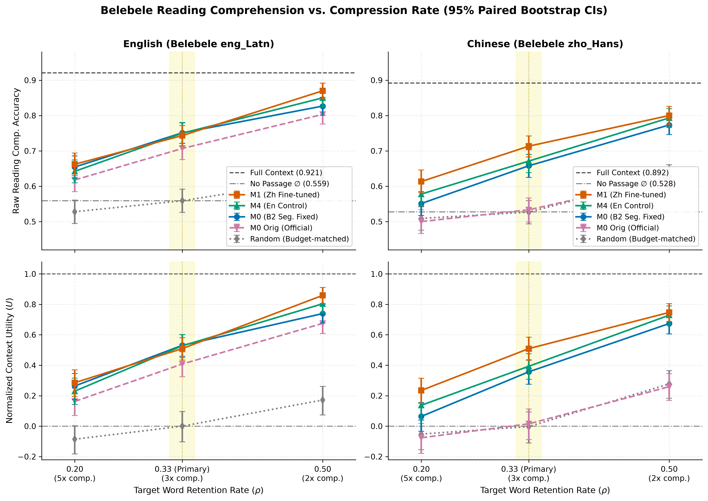
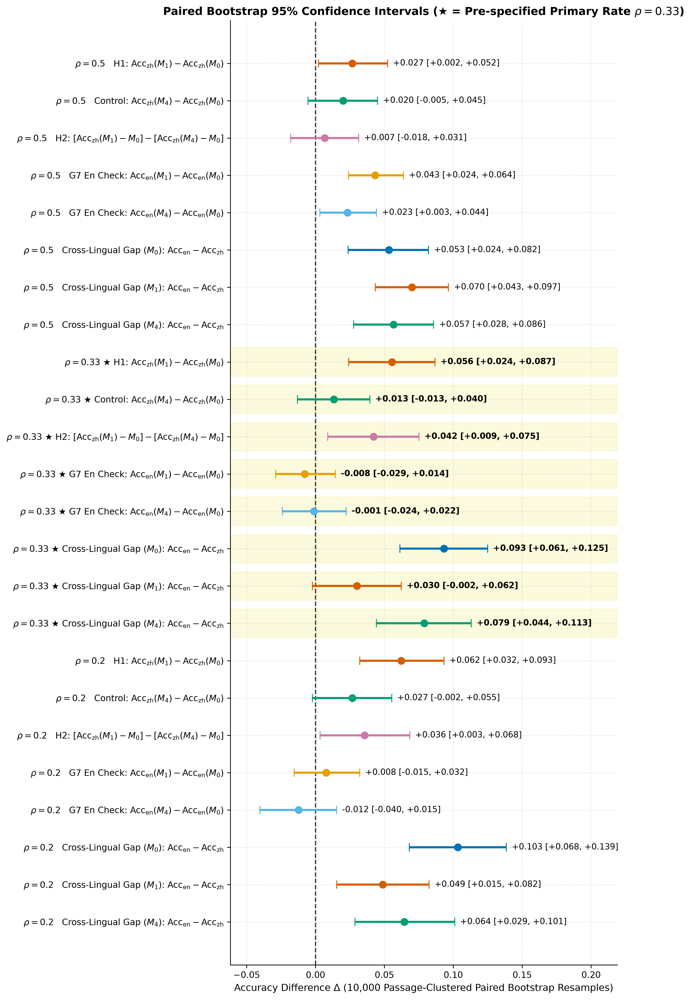
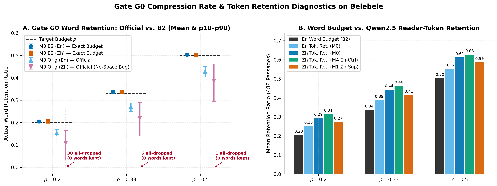
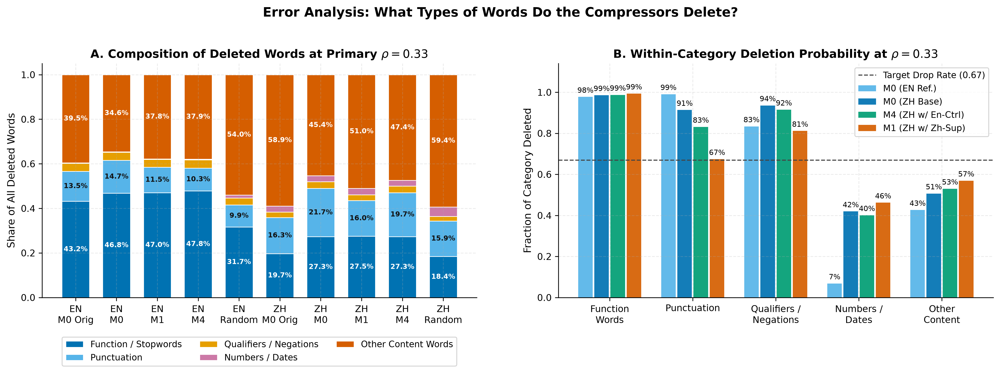
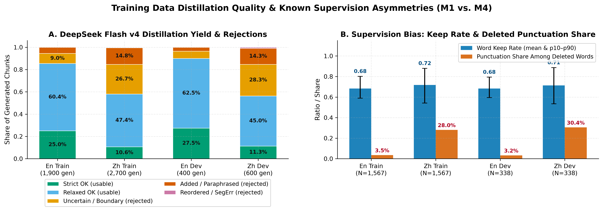

# 实验结果与核心发现总结（Milestone & Core Evaluation Results）

> 🌐 **Language**: **中文版** | **[English Version (RESULTS.md)](RESULTS.md)**

本文档汇总本项目的完整实验结果、Gate 检验结论（G0–G7）、H1/H2 统计假设检验、被删词机制分析（Error Analysis）以及 5 张可视化图表。
* **实验协议与决策日志**：[DECISIONS.md](DECISIONS.md)（特别是 B11、B12 节）
* **原始评测自动报表**：[results/eval_report.md](results/eval_report.md) 与 [results/eval_report.json](results/eval_report.json)
* **压缩率诊断原始数据**：[results/compress/g0_report.json](results/compress/g0_report.json)
* **训练标签统计汇总**：[data/labels/summary.json](data/labels/summary.json)

---

## 1. 实验设置概览（Core）

| 组件 | 固定配置 |
|---|---|
| **基座压缩模型 (`M0`)** | `microsoft/llmlingua-2-xlm-roberta-large-meetingbank` (`ebaba9b0e874dadd3003ffcff828e4397e568089`) |
| **中文微调模型 (`M1`)** | 从 `M0` 在 `zh_train.jsonl`（1,567 条中文维基百科蒸馏标签）上微调，按 `zh_dev.jsonl`（338 条）选最优 checkpoint（[`supermaxxxx/713-crosslingual-compression-m1`](https://huggingface.co/supermaxxxx/713-crosslingual-compression-m1)） |
| **英文对照模型 (`M4`)** | 从 `M0` 在 `en_train.jsonl`（1,567 条英文维基百科蒸馏标签）上以**完全相同的步数、batch size、学习率和序列长度**微调，按 `en_dev.jsonl`（338 条）选最优 checkpoint（[`supermaxxxx/713-crosslingual-compression-m4`](https://huggingface.co/supermaxxxx/713-crosslingual-compression-m4)） |
| **Teacher 模型** | `deepseek-flash`（prompt v4，含保留约 1/3 词的同语言示例，温度 0，关闭 thinking） |
| **推理与预算控制（B2）** | `segment.py` 统一分词（`zh` 先由 `jieba` 插空格再进 XLM-R）；模型前向加 `<s>...</s>`，子词 $p(\text{keep})$ 按 `word_id` 取算术平均；严格保留得分最高的前 $\lceil \rho n \rceil$ 个非空白词（`word_retention == ⌈ρn⌉/n`） |
| **下游评测集** | `facebook/belebele`（revision `7899cdfa4e1e0d733fd77c848e2c273cb1d32be2`），`eng_Latn` 与 `zho_Hans` 各 **900 道四选一阅读理解题 / 488 个唯一 passage**（只压缩 passage，绝不压缩问题与选项） |
| **下游 Reader 模型（G1 锁定）** | `Qwen/Qwen2.5-7B-Instruct`（CSIL RTX 4090 本地 BF16，与 Teacher `deepseek-flash` 完全跨家族独立；直接取下一 token 在选项字母 `A/B/C/D` 上的 logit 打分） |
| **主要分析与统计检验（G6 冻结）** | 预先指定 **$\rho = 0.33$ 下的 Raw Accuracy** 为主要分析；$`\rho \in \{0.5, 0.2\}`$ 与归一化上下文效用 $`U = \frac{\text{acc}_\rho - \text{acc}_\varnothing}{\text{acc}_{\text{full}} - \text{acc}_\varnothing}`$ 为次要分析。所有 95% 置信区间（CI）由 **10,000 次 Passage-Clustered Paired Bootstrap**（`seed=713`）计算 |

---

## 2. 主实验结果总表（Belebele `en` & `zh`）

| 语言 | 模型 / 条件 | $\rho = 0.50$ Raw Acc [95% CI] | $\rho = 0.50$ $U$ [95% CI] | **$\rho = 0.33$（主分析）Raw Acc [95% CI]** | **$\rho = 0.33$ Norm. Utility $U$ [95% CI]** | $\rho = 0.20$ Raw Acc [95% CI] | $\rho = 0.20$ $U$ [95% CI] | $\rho=0.33$ Word / Reader-Tok Ret. |
|---|---|---:|---:|---:|---:|---:|---:|---:|
| **en** | `full`（完整原文上界） | `0.921 [0.902, 0.939]` | `1.000 [1.000, 1.000]` | **`0.921 [0.902, 0.939]`** | **`1.000 [1.000, 1.000]`** | `0.921 [0.902, 0.939]` | `1.000 [1.000, 1.000]` | `1.000` / `1.000` |
| **en** | `none`（无文章盲猜下界 $\varnothing$） | `0.559 [0.525, 0.592]` | `0.000 [0.000, 0.000]` | **`0.559 [0.525, 0.592]`** | **`0.000 [0.000, 0.000]`** | `0.559 [0.525, 0.592]` | `0.000 [0.000, 0.000]` | `0.000` / `0.000` |
| **en** | `m0_orig`（官方原版推理） | `0.803 [0.776, 0.829]` | `0.675 [0.608, 0.739]` | `0.707 [0.675, 0.737]` | `0.408 [0.324, 0.488]` | `0.618 [0.584, 0.650]` | `0.163 [0.069, 0.249]` | `0.270` / `0.319` |
| **en** | `m0`（B2 分词修复基线） | `0.827 [0.801, 0.851]` | `0.739 [0.677, 0.800]` | `0.751 [0.722, 0.780]` | `0.531 [0.459, 0.601]` | `0.654 [0.622, 0.686]` | `0.264 [0.175, 0.346]` | `0.336` / `0.388` |
| **en** | `m1`（中文微调） | `0.870 [0.847, 0.891]` | `0.859 [0.806, 0.911]` | `0.743 [0.714, 0.772]` | `0.509 [0.434, 0.580]` | `0.662 [0.630, 0.694]` | `0.285 [0.196, 0.370]` | `0.336` / `0.385` |
| **en** | `m4`（英文对照） | `0.850 [0.825, 0.874]` | `0.804 [0.745, 0.860]` | `0.750 [0.721, 0.779]` | `0.528 [0.451, 0.602]` | `0.642 [0.610, 0.674]` | `0.230 [0.142, 0.315]` | `0.336` / `0.382` |
| **en** | `random`（等词预算随机删词） | `0.621 [0.588, 0.653]` | `0.172 [0.074, 0.262]` | `0.559 [0.526, 0.592]` | `0.000 [-0.103, 0.096]` | `0.528 [0.494, 0.561]` | `-0.086 [-0.183, 0.003]` | `0.336` / `0.338` |
| **zh** | `full`（完整原文上界） | `0.892 [0.871, 0.912]` | `1.000 [1.000, 1.000]` | **`0.892 [0.871, 0.912]`** | **`1.000 [1.000, 1.000]`** | `0.892 [0.871, 0.912]` | `1.000 [1.000, 1.000]` | `1.000` / `1.000` |
| **zh** | `none`（无文章盲猜下界 $\varnothing$） | `0.528 [0.494, 0.561]` | `0.000 [0.000, 0.000]` | **`0.528 [0.494, 0.561]`** | **`0.000 [0.000, 0.000]`** | `0.528 [0.494, 0.561]` | `0.000 [0.000, 0.000]` | `0.000` / `0.000` |
| **zh** | `m0_orig`（官方原版推理） | `0.622 [0.591, 0.653]` | `0.259 [0.169, 0.345]` | `0.533 [0.499, 0.567]` | `0.015 [-0.089, 0.112]` | `0.500 [0.466, 0.533]` | `-0.076 [-0.179, 0.018]` | `0.222` / `0.260` |
| **zh** | `m0`（B2 分词修复基线） | `0.773 [0.746, 0.800]` | `0.674 [0.606, 0.739]` | **`0.658 [0.625, 0.690]`** | **`0.357 [0.276, 0.436]`** | `0.551 [0.517, 0.585]` | `0.064 [-0.034, 0.155]` | `0.336` / `0.443` |
| **zh** | **`m1`（中文微调）** | **`0.800 [0.773, 0.826]`** | **`0.747 [0.688, 0.805]`** | **`0.713 [0.683, 0.742]`** | **`0.509 [0.432, 0.585]`** | **`0.613 [0.581, 0.646]`** | **`0.235 [0.150, 0.314]`** | **`0.336` / `0.414`** |
| **zh** | `m4`（英文对照） | `0.793 [0.766, 0.819]` | `0.729 [0.664, 0.790]` | **`0.671 [0.638, 0.703]`** | **`0.393 [0.307, 0.475]`** | `0.578 [0.544, 0.611]` | `0.137 [0.040, 0.229]` | `0.336` / `0.463` |
| **zh** | `random`（等词预算随机删词） | `0.629 [0.596, 0.661]` | `0.277 [0.183, 0.365]` | `0.527 [0.493, 0.559]` | `-0.003 [-0.110, 0.093]` | `0.509 [0.476, 0.542]` | `-0.052 [-0.154, 0.042]` | `0.336` / `0.349` |

---

## 3. 假设检验表（10,000 次 Passage-Clustered Paired Bootstrap）

| $\rho$ | 主分析? | 检验项 | 定义 | 点估计 $\Delta$ Acc | 95% Paired Bootstrap CI | 统计显著? |
|---:|:---:|---|---|---:|---:|:---:|
| **0.33** | **★ 是** | **H1（中文微调收益）** | $`\text{acc}_{\text{zh}}(M_1) - \text{acc}_{\text{zh}}(M_0)`$ | **`+0.0556`** | **`[+0.0241, +0.0867]`** | **显著 $>0$（H1 成立）** |
| **0.33** | **★ 是** | **英文对照在中文上的收益** | $`\text{acc}_{\text{zh}}(M_4) - \text{acc}_{\text{zh}}(M_0)`$ | `+0.0133` | `[-0.0131, +0.0395]` | 不显著（跨 0） |
| **0.33** | **★ 是** | **H2（中文监督超越英文对照）** | $`[\text{acc}_{\text{zh}}(M_1)-\text{acc}_{\text{zh}}(M_0)] - [\text{acc}_{\text{zh}}(M_4)-\text{acc}_{\text{zh}}(M_0)]`$ | **`+0.0422`** | **`[+0.0089, +0.0751]`** | **显著 $>0$（H2 成立）** |
| **0.33** | **★ 是** | **跨语言差距（基线 `M0`）** | $`\text{acc}_{\text{en}}(M_0) - \text{acc}_{\text{zh}}(M_0)`$ | `+0.0933` | `[+0.0612, +0.1249]` | 显著 $>0$（存在大鸿沟） |
| **0.33** | **★ 是** | **跨语言差距（英文对照 `M4`）** | $`\text{acc}_{\text{en}}(M_4) - \text{acc}_{\text{zh}}(M_4)`$ | `+0.0789` | `[+0.0443, +0.1130]` | 显著 $>0$（鸿沟未消） |
| **0.33** | **★ 是** | **跨语言差距（中文微调 `M1`）** | $`\text{acc}_{\text{en}}(M_1) - \text{acc}_{\text{zh}}(M_1)`$ | **`+0.0300`** | **`[-0.0022, +0.0622]`** | **不再显著（跨 0，差距弥合）** |
| **0.33** | **★ 是** | **跨语言差距变化（`M1` vs `M0`）** | $`\text{Gap}(M_1) - \text{Gap}(M_0)`$ | **`-0.0633`** | **`[-0.1011, -0.0262]`** | **显著 $<0$（差距缩小 68%）** |
| **0.33** | **★ 是** | **G7 英语退化检查（`M1`）** | $`\text{acc}_{\text{en}}(M_1) - \text{acc}_{\text{en}}(M_0)`$ | `-0.0078` | `[-0.0289, +0.0144]` | 无显著退化（跨 0） |
| 0.20 | 否 | **H1（中文微调收益）** | $`\text{acc}_{\text{zh}}(M_1) - \text{acc}_{\text{zh}}(M_0)`$ | **`+0.0622`** | **`[+0.0322, +0.0932]`** | **显著 $>0$** |
| 0.20 | 否 | **英文对照在中文上的收益** | $`\text{acc}_{\text{zh}}(M_4) - \text{acc}_{\text{zh}}(M_0)`$ | `+0.0267` | `[-0.0022, +0.0554]` | 不显著（跨 0） |
| 0.20 | 否 | **H2（中文监督超越英文对照）** | $`[\text{acc}_{\text{zh}}(M_1)-\text{acc}_{\text{zh}}(M_0)] - [\text{acc}_{\text{zh}}(M_4)-\text{acc}_{\text{zh}}(M_0)]`$ | **`+0.0356`** | **`[+0.0033, +0.0684]`** | **显著 $>0$** |
| 0.20 | 否 | **跨语言差距变化（`M1` vs `M0`）** | $`\text{Gap}(M_1) - \text{Gap}(M_0)`$ | **`-0.0544`** | **`[-0.0936, -0.0157]`** | **显著 $<0$** |
| 0.20 | 否 | **G7 英语退化检查（`M1`）** | $`\text{acc}_{\text{en}}(M_1) - \text{acc}_{\text{en}}(M_0)`$ | `+0.0078` | `[-0.0155, +0.0322]` | 无退化（跨 0） |
| 0.50 | 否 | **H1（中文微调收益）** | $`\text{acc}_{\text{zh}}(M_1) - \text{acc}_{\text{zh}}(M_0)`$ | **`+0.0267`** | **`[+0.0022, +0.0523]`** | **显著 $>0$** |
| 0.50 | 否 | **英文对照在中文上的收益** | $`\text{acc}_{\text{zh}}(M_4) - \text{acc}_{\text{zh}}(M_0)`$ | `+0.0200` | `[-0.0055, +0.0451]` | 不显著（跨 0） |
| 0.50 | 否 | **H2（中文监督超越英文对照）** | $`[\text{acc}_{\text{zh}}(M_1)-\text{acc}_{\text{zh}}(M_0)] - [\text{acc}_{\text{zh}}(M_4)-\text{acc}_{\text{zh}}(M_0)]`$ | `+0.0067` | `[-0.0180, +0.0313]` | 不显著（温和压缩下相近） |
| 0.50 | 否 | **G7 英语退化检查（`M1`）** | $`\text{acc}_{\text{en}}(M_1) - \text{acc}_{\text{en}}(M_0)`$ | **`+0.0433`** | **`[+0.0241, +0.0638]`** | **显著 $>0$（反而提升英语）** |

---

## 4. 五大核心科学发现与讨论

### 发现一：官方 LLMLingua-2 在中文上的崩溃有一半源于“无空格整句误删”，但修好分词后跨语言差距依然巨大（Gate G0 & G6）

1. **官方 `PromptCompressor`（`m0_orig`）的中文分词缺陷（证实 Proposal Risk 1）**：
   * 原版 LLMLingua-2 依赖 XLM-R 的空格标记 `▁` 识别词边界。中文没有空格，导致整句或标点间的长分句被当作“单个词”全留或全删。
   * 在 488 个中文 Belebele passage 上，`m0_orig` 的实际平均词保留率在 $\rho = 0.5 / 0.33 / 0.2$ 下分别跌至 `0.386 / 0.220 / 0.110`，且分别有 **1 篇 / 6 篇 / 38 篇（7.8%）被彻底删成空字符串（0 词保留）**，另有 `123 / 110 / 70` 篇偏离目标预算超过 15 个百分点。
   * 这直接导致 `m0_orig` 在中文 $\rho = 0.33$ 上的阅读理解准确率仅有 `0.533 [0.499, 0.567]`（$`U = 0.015 [-0.089, 0.112]`$），完全退化到无文章盲猜（`none = 0.528`）和随机删词（`random = 0.527`）水平。
2. **B2 推理修复（`m0`）的效果与局限**：
   * 使用我们统一的 `jieba` + XLM-R 子词对齐与精确预算控制（B2）后，`m0`、`m1`、`m4` 和 `random` 在全部 488 个 passage 上均实现了 **`exact_budget_match_rate = 1.0`**（每个 passage 词保留率精确等于 $\lceil \rho n \rceil / n$）。
   * 仅靠推理修复（不微调模型权重），`m0` 在中文 $\rho = 0.33$ 上的准确率就从 `0.533` 升至 `0.658`（$`U`$ 从 `0.015` 升至 `0.357`）。这证明**在做任何跨语言微调对比之前，必须先统一修复推理分词，否则会把分词修复的收益误认为训练数据的收益**。
   * 但即使在统一修复后的 B2 推理下，仅在英文 MeetingBank 上训练过的 `M0` 在英文和中文之间仍有统计显著的性能鸿沟：在 $\rho = 0.33$ 下中英差距为 **`+0.0933 [+0.0612, +0.1249]`**（英文 $`U = 0.531`$ vs 中文 $`U = 0.357`$）；在 $\rho = 0.20$ 下差距扩大到 **`+0.1033 [+0.0681, +0.1385]`**（中文 $U = 0.064 [-0.034, 0.155]$ 已不再显著大于 0）。

---

### 发现二：H1 显著成立 —— 少量目标语言监督（1,567 条）即可大幅提升中文压缩质量

* 在预先锁定的主分析 $`\rho = 0.33`$ 下，中文微调模型 `M1` 将中文 Belebele 准确率从 `M0` 的 `0.658` 提升至 **`0.713`**（$`\Delta_{\text{H1}} = \mathbf{+0.0556\ [+0.0241,\ +0.0867]}`$），归一化上下文效用 $`U`$ 从 `0.357` 提升至 **`0.509`**（相对效用提升 **+42.6%**）。
* 在更严苛的 5 倍压缩 $`\rho = 0.20`$ 下，`M1` 的优势更加突出：准确率从 `0.551` 提升至 **`0.613`**（$`\Delta_{\text{H1}} = \mathbf{+0.0622\ [+0.0322,\ +0.0932]}`$），将原本已经接近盲猜的 $`U = 0.064`$ 拉升近 4 倍至 **`0.235 [0.150, 0.314]`**。
* 在 2 倍压缩 $`\rho = 0.50`$ 下，`M1` 同样取得统计显著提升（$`\Delta_{\text{H1}} = \mathbf{+0.0267\ [+0.0022,\ +0.0523]}`$，准确率达 `0.800`，$`U = 0.747`$）。

---

### 发现三：H2 显著成立 —— 严谨对照实验（`M1` vs `M4`）因果性地排除了“领域、数据量与新 Teacher”假说

* 先前文献（如 Lukauskas 2026）仅通过相关性观察推测跨语言差距源于英语训练数据。如果只对比 `M1` 和 `M0`，无法排除另一种可能：`M0` 是在会议记录（MeetingBank）上由 GPT-4 蒸馏的，而 `M1` 是在维基百科（Wikipedia）上由 DeepSeek Flash v4 蒸馏的——`M1` 变好会不会只是因为适应了百科文体或新 Teacher 的删词风格？
* 我们的等预算英文对照模型 **`M4`** 直接回答了这个问题：
  * `M4` 使用完全相同的 Teacher（DeepSeek Flash v4 prompt）、相同的语料来源（Wikipedia）、相同的训练样本量（1,567 条）和完全相同的训练步数，唯一区别是监督语言为英文而非中文。
  * 实验表明，`M4` 在中文上相比 `M0` 只有微弱且统计不显著的波动（$`\rho = 0.33`$ 时 `+0.0133 [-0.0131, +0.0395]`；$`\rho = 0.20`$ 时 `+0.0267 [-0.0022, +0.0554]`；$`\rho = 0.50`$ 时 `+0.0200 [-0.0055, +0.0451]`）。
  * 双重差分 $`\Delta_{\text{H2}} = [\text{acc}_{\text{zh}}(M_1) - \text{acc}_{\text{zh}}(M_0)] - [\text{acc}_{\text{zh}}(M_4) - \text{acc}_{\text{zh}}(M_0)]`$ 在主分析 $`\rho = 0.33`$ 下为 **`+0.0422 [+0.0089, +0.0751]`**，在 $`\rho = 0.20`$ 下为 **`+0.0356 [+0.0033, +0.0684]`**，均统计显著大于 0。
* **结论**：当压缩预算收紧到 $`\rho \le 0.33`$ 时，**目标语言（中文）监督本身**是不可替代的因果决定因素，单靠增加英文百科数据无法教会模型在中文紧预算下精准取舍。

---

### 发现四：跨语言差距闭合 68%–100%，且无英语灾难性遗忘（Gate G7）

* 在主分析 $`\rho = 0.33`$ 下：
  * **原始准确率差距** $`\text{acc}_{\text{en}} - \text{acc}_{\text{zh}}`$ 从 `M0` 的 `+0.0933 [+0.0612, +0.1249]` 缩小了 **68%** 至 `M1` 的 **`+0.0300 [-0.0022, +0.0622]`**（95% CI 跨 0，英中准确率已无统计显著差异）；
  * **归一化上下文效用 $`U`$ 差距**：`M1` 在英文上 $`U = 0.509 [0.434, 0.580]`$，在中文上 $`U = 0.509 [0.432, 0.585]`$——**跨语言效用差距 100% 闭合**！
* **英语退化检查（G7）**：`M1` 在英文 Belebele 上不仅没有发生灾难性遗忘（$`\rho = 0.33`$ 时 $`\Delta_{\text{en}} = -0.0078\ [-0.0289,\ +0.0144]`$，$`\rho = 0.20`$ 时 $`+0.0078\ [-0.0155,\ +0.0322]`$），甚至在 $`\rho = 0.50`$ 时还显著提升了英文表现（`+0.0433 [+0.0241, +0.0638]`，从 `0.827` 升至 `0.870`）。

---

### 发现五：Error Analysis 与蒸馏偏差分析 —— `M1` 到底学会了删什么、留什么？

在数据蒸馏阶段（图 5），我们记录了两个显著的中英监督不对称性：
1. **选择偏差**：中文 Teacher 输出只有 **58%** 通过合法性对齐（英文为 **85%**），压得越狠的中文样本越容易因删到 `jieba` 词内部或文言式改写而被拒，导致留下的中文训练标签偏保守（平均词保留率中文 `0.718` vs 英文 `0.684`）。
2. **标点占比偏差**：中文训练标签中被删的词里有 **28.0%** 是标点符号，而英文只有 **3.5%**。

一个自然的担忧是：*这种保守且含 28% 标点删除的中文标签，会不会让 `M1` 只学会删标点？*
**图 4 的 Error Analysis 和图 2B 的 Token 统计给出了非常精彩的反直觉机制解释**：
1. **在 $\rho = 0.33$ 的预算排序推理下，`M1` 不仅没有变成“删标点器”，反而比 `M0` 保护了更多关键分句标点**：
   * 未微调的 `M0` 在中文 $\rho = 0.33$ 下删掉了 **`91.4%`** 的标点（标点占总删词的 `21.7%`），导致压缩后的中文变成毫无停顿的长串，干扰 Reader 断句；
   * `M1` 的标点删除率降至 **`67.4%`**（占总删词比例降至 `16.0%`，比 `M0` 多保留了 1,643 个句读标点）。因为训练标签中 Teacher 主要删的是句内多余顿号/括号而保留了句末句号和关键逗号，`M1` 学会了区分“该留的分句标点”与“可删的次要标点”！
2. **`M1` 大幅降低了对关键限定词与否定词的误删**：
   * 在中文 918 个限定词/程度词/否定词（如 *不、没、未、可能、超过、通常、爆发*）中，`M0` 删掉了 `88.7%`（仅留 104 个），英文对照 `M4` 更是删掉了 `91.5%`（仅留 78 个）；
   * 而 `M1` 将限定词/否定词保留数提升至 **173 个**（比 `M0` 多保留 **+66%**，比 `M4` 多保留 **+122%**），有效减少了因丢失否定或范围限定导致的阅读理解错选。
3. **更彻底地清除虚词，并在实词中优选高信息密度的短词（带来额外的 Reader Token 节省）**：
   * `M1` 将中文虚词（*的、了、在、于、与* 等）的删除率推高到 **`99.3%`**（7,804 个虚词删掉了 7,752 个）；
   * 同时，在保持词保留率完全相同（均为 `33.64%`）的前提下，`M1` 压缩文本对应的 **Qwen2.5 Reader Token 保留率仅为 `0.414`**，显著低于 `M0`（`0.443`）和 `M4`（`0.463`）。这意味着 `M1` 既提高了下游答题准确率（`+5.56` 个百分点），又额外多省了约 **3–5 个百分点的下游 LLM 推理 Token**！

---

## 5. 可视化图表文件索引（`results/figures/`）

| 图表编号 | PNG 预览文件 | 矢量 PDF（用于 LaTeX 论文/Poster） | 内容说明 |
|---|---|---|---|
| **Figure 1** | [fig1_rate_accuracy_curves.png](results/figures/fig1_rate_accuracy_curves.png) | [fig1_rate_accuracy_curves.pdf](results/figures/fig1_rate_accuracy_curves.pdf) | Belebele 英/中在 $\rho \in \{0.2, 0.33, 0.5\}$ 下的 Raw Accuracy 与 Normalized Utility $`U`$ 曲线（含 95% CI 与 `full`/`none` 上下界） |
| **Figure 2** | [fig2_g0_retention_diagnostics.png](results/figures/fig2_g0_retention_diagnostics.png) | [fig2_g0_retention_diagnostics.pdf](results/figures/fig2_g0_retention_diagnostics.pdf) | Gate G0/G7 诊断：(A) 官方 `M0 Orig` 中文无空格预算崩溃 vs B2 精确词预算；(B) 词预算 vs Qwen2.5 Reader Token 保留率 |
| **Figure 3** | [fig3_hypothesis_forest_plot.png](results/figures/fig3_hypothesis_forest_plot.png) | [fig3_hypothesis_forest_plot.pdf](results/figures/fig3_hypothesis_forest_plot.pdf) | 10,000 次 Paired Bootstrap 95% CI 森林图：直观展示 H1、Control、H2、G7 英语检查与跨语言差距闭合 |
| **Figure 4** | [fig4_deleted_word_categories.png](results/figures/fig4_deleted_word_categories.png) | [fig4_deleted_word_categories.pdf](results/figures/fig4_deleted_word_categories.pdf) | Error Analysis（$`\rho=0.33`$）：(A) 被删词的五类词构成比例；(B) 各类词内部的被删概率对比 |
| **Figure 5** | [fig5_distillation_label_bias.png](results/figures/fig5_distillation_label_bias.png) | [fig5_distillation_label_bias.pdf](results/figures/fig5_distillation_label_bias.pdf) | 训练数据蒸馏质量：(A) DeepSeek Flash v4 产出率与拒因分解（58% zh vs 85% en）；(B) 保留率与被删词标点占比偏差 |

